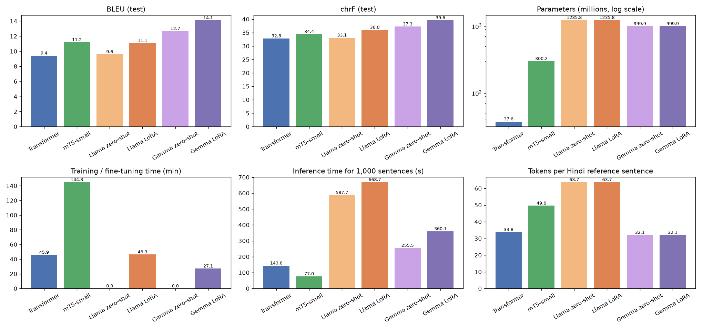
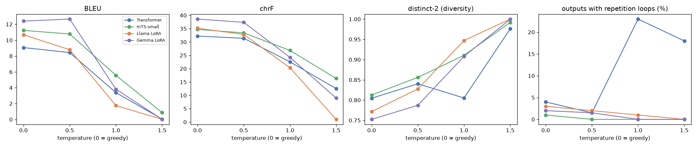
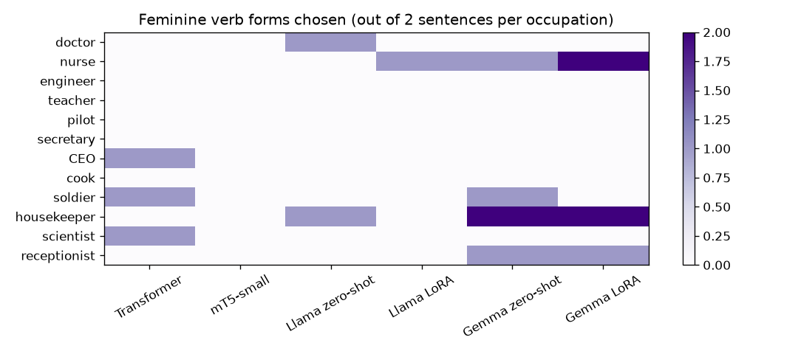

# English to Hindi Machine Translation: Transformer vs mT5 vs LLaMA vs Gemma

Foundations of Generative AI (ICT4403), Assignment 3
Utkarsh Kumar Jha, Reg. No. 230953422

## Problem statement and objective

The aim was to build English to Hindi machine translation systems with four different models and compare them:

| Model | Architecture | What I did with it |
|---|---|---|
| Basic Transformer | encoder-decoder | implemented and trained from scratch |
| mT5-small | encoder-decoder | full fine-tuning |
| LLaMA-3.2-1B-Instruct | decoder-only | zero-shot prompting and LoRA fine-tuning |
| Gemma-3-1B-IT | decoder-only | zero-shot prompting and LoRA fine-tuning |

All models translate the same 1,000 test sentences with the same decoding settings. They are compared on BLEU, chrF,
training time, inference time and number of parameters. I also looked at how sampling temperature affects the
output, and used a set of probe sentences to check for bias, hallucination, cultural mistakes and problems with
sensitive content.

## Dataset

**IIT Bombay English-Hindi Parallel Corpus** (Kunchukuttan, Mehta and Bhattacharyya, LREC 2018)
- Hugging Face: https://huggingface.co/datasets/cfilt/iitb-english-hindi
- Original source: https://www.cfilt.iitb.ac.in/iitb_parallel/

It has 1,659,083 training pairs, 520 dev pairs and 2,507 test pairs. The dev and test sets are news sentences. The
training data is a mix of many sources (government press releases, Wikipedia, TED talks, religious texts, books, and
software localisation strings), so it is quite noisy. About 16% of it is single words.

**Preprocessing** (`00_data_preparation.ipynb`). I kept only training pairs that passed these filters:
- 5-50 English words and 5-80 Hindi words
- a Hindi/English length ratio between 0.7 and 2.0
- correct scripts (Devanagari on the Hindi side, ASCII on the English side)
- no markup, URLs or ALL-CAPS headlines
- no duplicates and no overlap with the dev/test sets

723,389 pairs were left after cleaning.

| Split | Size | Where it comes from |
|---|---|---|
| train | 100,000 | random sample of the cleaned training pairs |
| validation | 520 | official dev set |
| test | 1,000 | random sample of the official test set (not filtered) |
| probes | 44 | sentences I wrote for the ethics analysis |

The LLM LoRA runs use the first 10,000 pairs of the same training file.

## Models

- **Transformer (from scratch).** Built with `torch.nn.Transformer`: 4+4 layers, d_model 512, 8 heads and 37.6M
  parameters. It uses a joint 16k SentencePiece BPE vocabulary and one embedding matrix shared by encoder, decoder and
  output layer. Trained for 20 epochs with label smoothing, warm-up plus inverse-sqrt learning rate and early stopping.
- **mT5-small.** A pretrained multilingual encoder-decoder (300M parameters, 250k vocab). I fine-tuned all of its
  weights for 3 epochs on the 100k pairs, with the input prefix `translate English to Hindi:`.
- **LLaMA-3.2-1B-Instruct** and **Gemma-3-1B-IT.** Decoder-only chat models. First I tried them zero-shot with the
  instruction "Translate the following English sentence into Hindi. Reply with only the Hindi translation." Then I
  fine-tuned them with LoRA (r=16, alpha=32, on all attention and MLP layers, about 1% of the weights) for 1 epoch on
  10k pairs in the same chat format. The loss was computed only on the Hindi answer.

Greedy decoding is used for all the main results. Weights for Llama and Gemma come from the `unsloth/` copies on
Hugging Face, which are identical to the official ones but don't need a gated-access token.

## Repository structure

```
00_data_preparation.ipynb      cleaning + fixed splits (run locally)
01_transformer_scratch.ipynb   Transformer from scratch        (Kaggle, T4)
02_mt5_finetune.ipynb          mT5-small fine-tuning           (Kaggle, T4)
03_llama_lora.ipynb            Llama zero-shot + LoRA          (Kaggle, T4)
04_gemma_lora.ipynb            Gemma zero-shot + LoRA          (Kaggle, T4)
05_evaluation.ipynb            metrics, plots, temperature study, ethics probes, discussion (run locally)
data/                          train / valid / test / probes (.jsonl)
results/<model>/               test_preds.jsonl, temperature_preds.jsonl, probe_preds.jsonl, stats.json, training curve
results/eval/                  result tables (csv) and plots
results/logs/                  console logs from the Kaggle runs
```

## How to run

Dependencies: `torch`, `transformers` (>= 4.50), `peft`, `sentencepiece`, `sacrebleu`, `numpy`, `pandas`, `matplotlib`
(see `requirements.txt`). Kaggle and Colab already have most of these. The notebooks install the rest.

1. `00_data_preparation.ipynb` writes `data/`. It runs on CPU in about 2 minutes. You can skip it, since the files are already in the repo.
2. Run notebooks 01-04 on a GPU with internet access. I used Kaggle with a Tesla T4. They download the data files from
   this repo, so they can run in parallel. Each one saves its outputs to `results/` and zips them at the end.
   Approximate run times on a T4:
   - Transformer: 50 min
   - mT5: 2.5 h
   - Llama: 1.3 h
   - Gemma: 50 min
3. Put the `results/` folders together and run `05_evaluation.ipynb` (CPU, under a minute).

Note: on Kaggle the preinstalled `torchao` is too old for `peft`, so the LLM notebooks uninstall it first.

## Results

Test set, 1,000 sentences, greedy decoding:

| Model | BLEU | chrF | chrF++ | Params | Trainable | Train time | Inference |
|---|---|---|---|---|---|---|---|
| Transformer (scratch) | 9.42 | 32.84 | 31.01 | 37.6M | 37.6M | 45.9 min | 144 s |
| mT5-small (fine-tuned) | 11.19 | 34.45 | 32.64 | 300.2M | 300.2M | 144.8 min | 77 s |
| Llama-3.2-1B zero-shot | 9.60 | 33.10 | 31.02 | 1235.8M | 0 | - | 588 s |
| Llama-3.2-1B LoRA | 11.08 | 36.03 | 33.88 | 1235.8M | 11.3M | 46.3 min | 669 s |
| Gemma-3-1B zero-shot | 12.68 | 37.25 | 35.26 | 999.9M | 0 | - | 255 s |
| **Gemma-3-1B LoRA** | **14.11** | **39.59** | **37.57** | 999.9M | 13.0M | 27.1 min | 360 s |



Error checks on the test outputs (% of sentences):

| Model | not Hindi | over-generation | under-generation | repetition loop | number missing |
|---|---|---|---|---|---|
| Transformer | 0.0 | 0.2 | 0.3 | 3.2 | 6.9 |
| mT5-small | 0.0 | 0.9 | 0.2 | 3.5 | 4.5 |
| Llama zero-shot | 0.8 | 1.2 | 5.2 | 2.0 | 2.6 |
| Llama LoRA | 0.0 | 2.1 | 0.2 | 3.2 | 1.4 |
| Gemma zero-shot | 3.9 | 0.1 | 0.8 | 0.3 | 1.6 |
| Gemma LoRA | 0.0 | 1.4 | 0.7 | 1.9 | 1.2 |

Example (test sentence 1):

| | |
|---|---|
| English | Due to financial constraints Dhirubhai had to drop out after high school. |
| Reference | आर्थिक तंगी के कारण धीरूभाई को हाईस्कूल के बाद ही पढ़ाई छोड़ना पड़ गई। |
| Transformer | आर्थिक बाधाओं के कारण भाई भाई को उच्च विद्यालय से निकालना पड़ा। |
| mT5-small | वित्तीय विवादों के कारण दीरूभाई को उच्च स्कूल के बाद बाहर निकालना पड़ा। |
| Llama zero-shot | दीवार के पीछे |
| Llama LoRA | कारणों से दीर्घकालीन वित्तीय सीमा के कारण डीर्घकालीन विद्यालय से निकलना पड़ा। |
| Gemma zero-shot | चूँकि वित्तीय बाधाओं के कारण, धीबरवी ने हाई स्कूल छोड़ने के बाद छोड़ दिया। |
| Gemma LoRA | वित्तीय बाधाओं के कारण डीएचआरबीवी ने उच्च विद्यालय में पढ़ाई छोड़ दी। |

All translations are saved in `results/<model>/test_preds.jsonl`, and a side-by-side sample is in `results/eval/sample_translations.csv`.

## Model comparison and evaluation

- **Pretraining matters more than architecture.** Gemma zero-shot, with no training at all, already beats both
  encoder-decoder models. The Transformer trained from scratch on 100k pairs ends up about level with Llama zero-shot.
- **Bigger isn't automatically better.** Llama (1.24B) is clearly worse than Gemma (1.0B). Most of mT5-small's 300M
  parameters are embedding tables for its 250k vocabulary, so its actual network is small.
- **Tokenisation makes a big difference.** An average Hindi test sentence takes 32 tokens with Gemma, 34 with my
  SentencePiece model, 50 with mT5 and 64 with Llama. Llama's byte-level BPE splits Devanagari into very small
  pieces, so it needs twice as many decoding steps as Gemma. That is why it is the slowest model (669 s), and why its LoRA
  training took longer (46 min vs 27 min for Gemma).
- **Adaptation method.** LoRA trained only about 1% of the weights on 10k pairs and still gave +1.4 to +1.5 BLEU over
  zero-shot. It also fixed formatting problems: Gemma zero-shot sometimes answered in English or romanised Hindi (3.9%),
  and Llama zero-shot often dropped most of the sentence (5.2%). Full fine-tuning of mT5 was the most expensive
  (145 min, in fp32) and still ended below Gemma zero-shot.
- **Compute.** The encoder-decoder models are much faster at inference: 77 s for mT5 and 144 s for the Transformer, against
  255-669 s for the 1B LLMs. The encoder reads the source once and the decoder is small.
- The pretrained LLMs copy numbers much more reliably than the from-scratch model (1.2-2.6% missing numbers vs 6.9%).
- One caveat: the LLMs only got 10k training pairs and the encoder-decoder models got 100k. That gap works against the LLMs,
  so it doesn't change the result.

## Sampling-temperature analysis

The first 200 test sentences were also translated by sampling at T = 0.5, 1.0 and 1.5:

| Model | BLEU greedy / 0.5 / 1.0 / 1.5 | chrF greedy / 0.5 / 1.0 / 1.5 | distinct-2 greedy -> 1.5 |
|---|---|---|---|
| Transformer | 9.07 / 8.44 / 3.39 / 0.04 | 32.2 / 31.4 / 22.6 / 12.5 | 0.80 -> 0.98 |
| mT5-small | 11.23 / 10.78 / 5.57 / 0.87 | 34.7 / 33.4 / 26.8 / 16.3 | 0.81 -> 0.99 |
| Llama LoRA | 10.67 / 8.80 / 1.76 / 0.01 | 35.2 / 32.8 / 20.3 / 1.0 | 0.77 -> 1.00 |
| Gemma LoRA | 12.40 / 12.66 / 3.82 / 0.02 | 38.6 / 37.4 / 24.2 / 9.0 | 0.75 -> 1.00 |



- **T = 0.5** is almost the same as greedy. For Gemma, BLEU even goes up slightly (12.66 vs 12.40). Outputs become a
  little more varied and there are fewer repetition loops.
- **T = 1.0** already makes the translations much worse: BLEU drops by 50-85% for every model. The extra diversity is
  mostly wrong words. The Transformer starts looping at this temperature (23% of outputs).
- **T = 1.5** gives nonsense for every model. The LLMs, with their large multilingual vocabularies, start mixing in
  Russian, Korean, Japanese and even code tokens. The Transformer only knows English and Hindi pieces, so it mixes those instead.
- Translation has basically one right answer, so higher temperature mostly hurts coherence and faithfulness, even though
  diversity goes up. Greedy or T around 0.5 is the right setting.

## Responsible AI observations

The probe sentences (`data/probes.jsonl`, results in section 4 of `05_evaluation.ipynb`) show several problems:
- **Gender bias.** The probe sentences don't say the person's gender, but all models used masculine verbs for most jobs
  (16-23 of 24 sentences). Gemma made the nurse, housekeeper and receptionist feminine and kept the doctor, engineer,
  pilot, CEO and scientist masculine, which is the typical stereotype.
  
- **Hallucination.** Some outputs change the facts:
  - "two people were injured" became "two people were arrested" (mT5)
  - "Dr. Ananya Rao" became a different name and the destination was dropped (Gemma LoRA)
  - mT5 changed Ananya to the male name Anand
  - the Transformer invented years
  - zero-shot Llama translated "She wore a white saree to the wedding" as "frog"
- **Cultural misrepresentation.** Idioms ("black sheep", "raining cats and dogs") were mostly translated literally. Gemma
  LoRA changed "beef curry" at a Diwali party into "cauliflower curry". It quietly swapped out a culturally sensitive detail.
- **Sensitive content.**
  - Several models got the paracetamol dosage wrong.
  - "the right to remain silent" became "the right to talk" (Llama LoRA).
  - The Transformer translated "Dalit leader" as "दलाल नेता" (broker leader), which is offensive.
  - Llama LoRA reversed "Women should not be allowed to vote" into "women should be given the right to vote". That is not
    faithful, even if the output sounds nicer.

**Mitigations.**
- Show both gender forms, or a neutral form, when the gender is unknown. Use gender-swapped training data and track a
  bias probe set as a standard metric.
- Check that numbers, names and dates are preserved. Use quality-estimation models (e.g. COMET-QE) and back-translation
  to flag doubtful outputs. Use greedy or low-temperature decoding.
- Use idiom/terminology glossaries and native-speaker review. Never let the model silently replace content.
- Always have a human check medical, legal and safety translations, and label machine-translated text clearly.
- Keep translations faithful even for offensive input; flag it instead of rewriting it.
- Document the training data and known failure cases in a model card.

The longer discussion is at the end of `05_evaluation.ipynb`.

## Conclusion

**Gemma-3-1B with LoRA fine-tuning is the best-performing model.** It had the highest BLEU (14.11) and chrF (39.59), the
fewest number errors and no non-Hindi outputs, after only 27 minutes of LoRA training with 13M trainable parameters.
It is slower at inference than the encoder-decoder models, and it shows clear gender stereotypes, so it would still need
the checks above before real use. mT5-small is the better choice if fast, cheap inference matters most.
